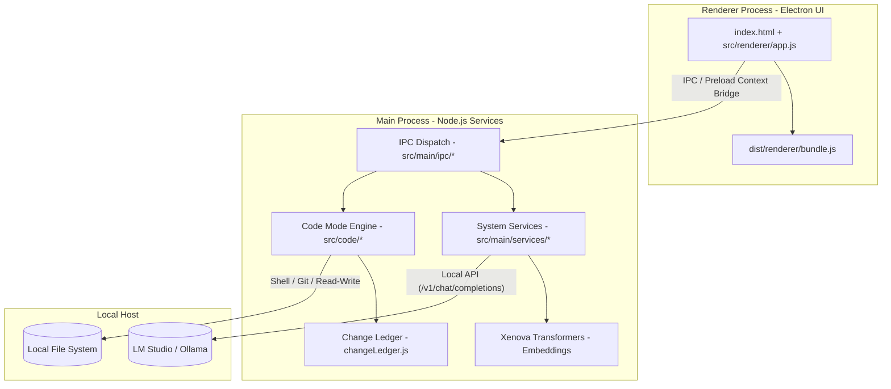
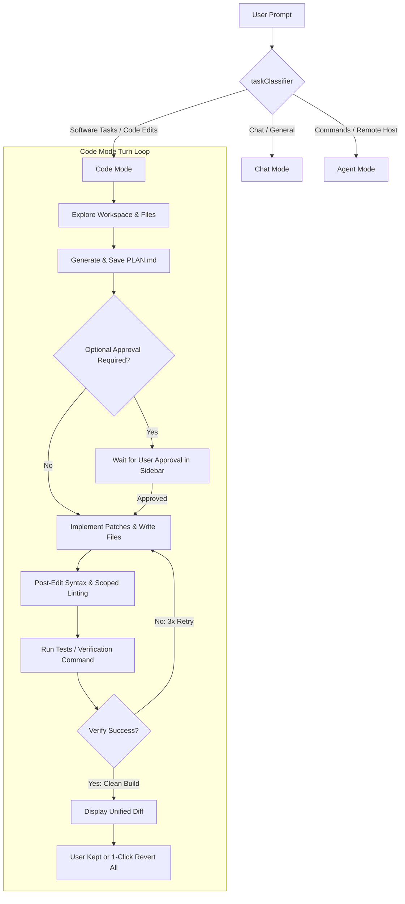

<p align="center">
  
</p>

<h1 align="center">Agent Smith Reloaded</h1>

<p align="center">
  <strong>An autonomous, local-first AI coding agent built for consumer hardware 32gig Edition with dedicated coding pipeline.</strong><br>
  Run Gemma, Qwen, and other local models on your own machine. Auto-route coding tasks to an autonomous build engine with patch-first edits, self-verification, and a byte-exact undo safety net.
</p>

<p align="center">
  <a href="https://github.com/YOUR_GITHUB_USERNAME/agent-smith/releases/tag/v56.2.0"></a>
  <a href="LICENSE"></a>
  
  
  
</p>

<p align="center">
  <a href="#key-features">Key Features</a>
  &nbsp;·&nbsp;
  <a href="#architecture--workflow">Architecture</a>
  &nbsp;·&nbsp;
  <a href="#quick-start">Quick Start</a>
  &nbsp;·&nbsp;
  <a href="#operating-modes">Operating Modes</a>
  &nbsp;·&nbsp;
  <a href="#security--guardrails">Security & Guardrails</a>
  &nbsp;·&nbsp;
  <a href="#developer-guide">Developer Guide</a>
</p>

---

## 🕶️ What is Agent Smith reloaded?

**Agent Smith reloaded** is an elite desktop developer's cockpit that transforms locally hosted language models (7B–35B) into capable autonomous build partners. Unlike chat-only wrapper interfaces, Agent Smith reads your workspace, constructs detailed execution plans, edits your files, runs shell commands, verifies results, and presents you with a clean visual diff—**all running 100% locally on your machine.** 

for users with vram lower than 32gigs we have agent smith resurrected which doenst contain the coding pipeline 

Designed from the ground up for absolute **privacy, extreme control, and predictable agent behavior**, it ensures your codebase never leaves your side of the wire.

> **Your machine. Your model. Your codebase. Zero Cloud Keys Required.**

---

## ⚡ Key Features

*   **🧠 Embedded Embedding Model (New in v55.1):** Out-of-the-box, local, zero-config semantic memory! Utilizes the bundled `all-MiniLM-L6-v2` transformer model (via `@xenova/transformers`) running in-process on CPU. No external cloud endpoints or LM Studio embedding configurations are required.
*   **🛠️ Autonomous "Code Mode":** A dedicated multi-turn agent loop that plans, implements, self-corrects, and validates changes autonomously.
*   **🛡️ The Trust Layer (Byte-Exact Revert All):** Every single file mutation is recorded by a local `changeLedger` before writing. At any point, review a unified diff of your workspace and perform a **1-click Revert All** to restore the exact pre-run state of your code.
*   **🚦 Intelligent Auto-Routing:** A real-time classifier parses your input. Coding tasks automatically launch the autonomous Build loop, while general questions, terminal commands, or file lookups get conversational Chat or whole-machine Agent tools.
*   **🌲 Git Worktree Isolation:** Run risky builds and speculative features in an isolated, temporary Git worktree under `.agentsmith/worktrees/`, keeping your active branch pristine.
*   **🧪 Grind Until Green:** Blocks completion of tasks until your project's syntax checks, linter, unit tests, and acceptance checks (`browser_verify` headless tests) pass.
*   **🦾 Small-Model Discipline:** Features the **Gemma Harness**—custom system prompt folding, tool JSON preambles, and message compaction designed specifically to extract reliable, reliable reasoning from smaller 7B-14B models.
*   **📱 Remote Mobile Cockpit:** Generates a local LAN/tunnel address and a secure QR code. Scan it to control and monitor Agent Smith's build loop directly from your phone and smith can share files for anything on your host machine u ask for via providing user with a download link that can be used remotely to download files.
*   **🔌 Extensible Plugin System:** Add custom developer tools, environment hooks, and shell controls using the sandboxed plugin manager.

---

## 🏗️ Architecture & Workflow

Agent Smith leverages a decoupled Process Model. High-level planning, file manipulation, and shell tools execute in the Node.js **Main Process**, while the user interface and event timeline stream in the Electron **Renderer Process**.

### Process Model



### Auto-Routing & Code Mode Loop

Each prompt is evaluated by `taskClassifier.js` to decide if it should trigger a plain chat, host commands, or Code Mode. While inside Code Mode, the loop advances through distinct milestones.



---

## 🚦 Operating Modes

Agent Smith partitions tasks into three distinct, mutually-isolated execution scopes to guarantee safety:

| Feature | **Chat Mode** | **Agent Mode** | **Code Mode** |
| :--- | :--- | :--- | :--- |
| **Primary Intent** | Standard conversation, research, and general queries | OS interaction, script running, process control | Autonomous code creation, editing, and bug fixing |
| **Tools Allowed** | None (Local Memory / Web retrieval optional) | Read-only file tools, terminal execution, system inspection | Full workspace mutation (write, append, patch, execute) |
| **Workspace Safety** | Absolute (No file mutations possible) | Guarded (Blocked paths, command denylist) | Secure (Full sandbox, snapshot ledger, Revert All) |
| **Execution Loop** | Simple Stream Response | Stream + single-turn tool calls | Multi-turn phase gates (Explore &rarr; Plan &rarr; Write &rarr; Verify) |
| **Planning System** | None | None | Durable on-disk `.agentsmith/PLAN.md` |

> 💡 **User Tip:** You can force a specific route using prefixes! Prepending your message with `code:` forces Code Mode (e.g., `code: add a login page`), while `agent:` forces conversational mode (e.g., `agent: explain what ports are listening`).

---

## 🔒 Security & Guardrails

Agent Smith is engineered as a local assistant with active brakes, not an unguided autopilot:

*   **🚫 Path Containment:** The file-handling engine prevents directory traversal attacks. It automatically rejects relative path escapes (`..`) and absolute paths outside the designated workspace.
*   **⛔ Command Policy Denylist:** The shell executor automatically blocks catastrophic system commands (e.g., `rm -rf /`, `mkfs`, fork bombs, raw scripts piped from curl).
*   **🧩 Sandboxed Plugins:** Custom extensions execute in an isolated environment under Node.js's permission model when running with `AGENT_SMITH_PLUGIN_SANDBOX=1`. Plugin integrity hashes guarantee that extensions cannot be modified in transit.
*   **🌐 Network Guard:** All egress connections are strictly monitored, audited, and restricted to verified endpoints via `netGuard.js`.
*   **🖥️ Hardened Renderer:** Strict Content Security Policies (CSP), blocked frame navigations, and isolated context bridges block untrusted scripts. Sudo password prompts are passed securely via standard input.

---

## 🚀 Quick Start

### 1. Fire up LM Studio

Open **LM Studio** and verify your local server is running at:
```http
http://localhost:1234
```
Ensure you have loaded your chosen Chat/Code model (e.g., Qwen-2.5-Coder, Gemma-2-9B). Agent Smith will automatically use its built-in transformer model for embeddings on memory tasks!

### 2. Launch Agent Smith

Agent Smith features intelligent, cross-platform launchers that verify local package environments and boot native modules cleanly:

```bash
# On Linux & macOS:
bash run.sh
```

```bat
:: On Windows:
run.cmd
```

Alternatively, you can start manually via npm:
```bash
npm install
npm start
```

### 3. Choose your workspace

1. Click **📍 Here I am** and select your project's directory.
2. Toggle **CODE MODE** on the left panel.
3. Describe the module or bug-fix you want to implement.
4. Watch the step-by-step progress timeline. Once complete, review the generated diff or hit **Revert All** if you want a clean slate!

---

## 🛠️ Developer Guide

### Prerequisites
*   [Node.js](https://nodejs.org/) (v18.x or later)
*   [LM Studio](https://lmstudio.ai/) (with local API enabled)

### Build from source & Bundle
```bash
npm install
npm run build:renderer
npm start
```

### Build installers (Debian / AppImage)
```bash
npm run dist              # Outputs installers in the release/ directory
npm run install-desktop   # Creates Linux Desktop entry / application shortcut
```

### Run Tests & Verification
```bash
npm test                          # Runs entire unit test suite
node scripts/verify-main-ipc.js   # Asserts correct IPC registration patterns
npm run ship-check                # Full pre-ship lint and format check
```

---

## 📁 Repository Map

```
├── main.js                 # Electron main bootstrap and OS lifecycle
├── preload.js              # Hardened ContextBridge preload script
├── package.json            # Dependencies and platform build config
├── src/
│   ├── code/               # Code Mode Engine (turn loop, phase gates, completion gate)
│   ├── main/               # Electron main services & extracted IPC handlers
│   ├── renderer/           # User Interface (sidebar, chat timeline, workspace review)
│   └── shared/             # Shared helpers, command policies, and net-guards
├── tests/                  # Robust unit, integration, and security tests
├── docs/                   # Full documentation on Plugins, Profiles, and Code Mode
└── AGENTS.md               # Onboarding map for AI agents building the codebase
```

---

## 📦 Electron Depot — build assets (auto-downloaded)

Code Mode packaging (`npm run dist`) needs Electron runtime zips + builder toolsets (~576 MB). To keep this repo small, the depot **archives are not committed** — only their extracted toolset dirs and `.state` markers live in `vendor/`. On first launch the app auto-detects what's missing from your local cache and downloads it (live progress in the sidebar **BUILD ASSETS** section; manifest: `src/shared/electronAssetsManifest.js`).

If you want `vendor/` fully populated locally (offline dev, re-seeding):

```bash
node scripts/fetch-electron-assets.js                  # all missing archives → ./vendor
node scripts/fetch-electron-assets.js --only <name>    # one asset
```

---

## 📜 License

This project is licensed under the [MIT License](LICENSE).

<p align="center">
  <sub>Agent Smith Reloaded v55.3.0 · Designed for Local Models. Secured for Enterprise Codebases.</sub>
</p>
